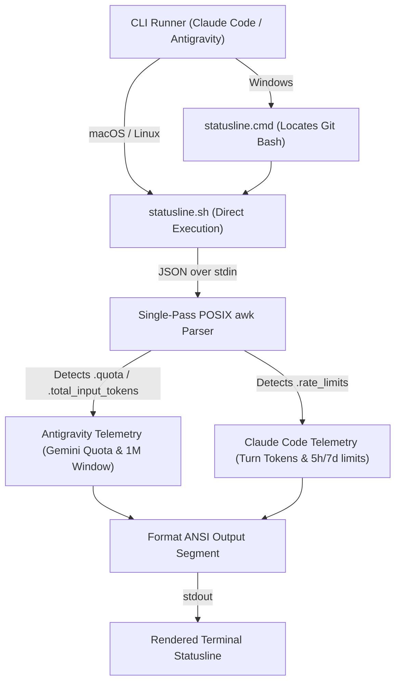

# lite-hud

Lightweight zero-dependency statusline for **Claude Code** and **Google Antigravity CLI (`agy`)**. Pure bash and POSIX awk — works across macOS, Linux, and Windows without Node.js or Python runtime requirements.

```text
[Gemini 3.8 Flash] 📁 my-project | 🌿 main ↑1 | 📊 34K (3%) | 5h: 47%
[3-7-sonnet]       📁 my-project | 🌿 main     | 📊 16K (8%) | 5h: 42% | 7d: 15%
```


---

## Output Format Breakdown

| Segment | Example | Description |
| :--- | :--- | :--- |
| **Model** | `[Gemini 3.8 Flash]` / `[3-7-sonnet]` | Current active model (clean name with effort/prefixes stripped) |
| **Directory** | `📁 my-project` | Basename of active workspace / current working directory |
| **Git Info** | `🌿 main ↑2↓1` | Branch name + colored commit count ahead (green) / behind (red) |
| **Token Usage** | `📊 34K (3%)` | Active context tokens in `K` / `M` + integer percentage used |
| **5h Rate** | `5h: 47%` | 5-hour rate limit or quota usage (colored warning) |
| **7d Rate** | `7d: 20%` | 7-day rate limit or quota usage (optional) |

---

## Installation & Setup

You can use `lite-hud` with **Claude Code**, **Antigravity CLI**, or **both at the same time**.

### 1. Antigravity CLI Setup

#### On Linux / macOS:
Inside Antigravity CLI chat:
```text
/statusline <path-to-lite-hud>/statusline.sh
```
Or run the automatic CLI setup:
```bash
./statusline.sh --setup-agy
```

#### On Windows:
> [!IMPORTANT]
> On Windows, do **not** point directly to `statusline.sh`. Windows will treat `.sh` as an unrecognized script and repeatedly open it in your text editor (VS Code / Notepad). Instead, use the native **`statusline.cmd`** wrapper or prefix with `bash`.

Inside Antigravity CLI chat on Windows (do not surround path with quotes):
```text
/statusline C:\path\to\lite-hud\statusline.cmd
```
*(or run `./statusline.sh --setup-agy` inside Git Bash, which auto-detects Windows and registers `statusline.cmd`)*.

---

### 2. Claude Code Setup

```bash
# Add marketplace
/plugin marketplace add https://github.com/ryan0x4/Claude.statusline.git

# Install
/plugin install lite-hud@lite-hud

# Configure statusline
/lite-hud:setup
```
Restart Claude Code after setup.

*(On Windows, ensure `~/.claude/settings.json` points to `statusline.cmd`)*.

---

### 3. Manual `settings.json` Configuration

If you prefer editing configuration files directly:

- **Linux / macOS** (`~/.gemini/antigravity-cli/settings.json` or `~/.claude/settings.json`):
  ```json
  {
    "statusLine": {
      "type": "command",
      "command": "/path/to/lite-hud/statusline.sh"
    }
  }
  ```

- **Windows** (`~/.gemini/antigravity-cli/settings.json` or `~/.claude/settings.json`):
  ```json
  {
    "statusLine": {
      "type": "command",
      "command": "C:\\path\\to\\lite-hud\\statusline.cmd"
    }
  }
  ```

---

## Configuration

`lite-hud` searches for configuration in the following order:
1. `~/.claude/plugins/lite-hud/config.json`
2. `~/.config/lite-hud/config.json`

Example `config.json`:
```json
{
  "debug": false,
  "git": {
    "enabled": true,
    "show_ahead_behind": true,
    "ahead_color": "32",
    "behind_color": "31"
  },
  "rate_limit_5h": {
    "enabled": true,
    "warning_threshold": 0,
    "warning_color": "33"
  },
  "usage_7d": {
    "enabled": true,
    "warning_threshold": 80,
    "warning_color": "33"
  }
}
```

### Options

| Setting | Type | Default | Description |
| :--- | :--- | :--- | :--- |
| `debug` | boolean | `false` | When `true`, logs raw stdin JSON to `~/.claude/statusline-debug.log` |
| `git.enabled` | boolean | `true` | Toggle Git branch and status display |
| `git.show_ahead_behind` | boolean | `true` | Toggle `↑ahead` and `↓behind` commit counts |
| `git.ahead_color` | string | `"32"` | ANSI color for ahead commits (32=green) |
| `git.behind_color` | string | `"31"` | ANSI color for behind commits (31=red) |
| `rate_limit_5h.enabled` | boolean | `true` | Toggle 5-hour rate limit / quota indicator |
| `rate_limit_5h.warning_threshold` | number | `0` | Minimum % to display warning (`0` = always show) |
| `rate_limit_5h.warning_color` | string | `"33"` | ANSI color for 5h warning (33=yellow) |
| `usage_7d.enabled` | boolean | `true` | Toggle 7-day rate limit / quota indicator |
| `usage_7d.warning_threshold` | number | `80` | Only display 7d rate when usage exceeds this % |

---

## How It Works Under the Hood

Both Claude Code and Antigravity execute the statusline script on each prompt/turn and stream a JSON telemetry payload to `stdin`. `lite-hud` handles both in a single non-blocking POSIX awk pass:



- **Windows Compatibility**: Ships with `statusline.cmd` to seamlessly invoke Git Bash without triggering Windows file-association dialogs or editor popups. Strips CRLF (`\r`) in stdin and Git outputs to prevent arithmetic syntax errors.
- **Antigravity CLI**: Extracts cumulative context tokens from `context_window.total_input_tokens` and 5h rate from `quota["gemini-5h"].remaining_fraction`.
- **Claude Code**: Extracts turn tokens from `context_window` cache/input/output counts and 5h/7d rates from `rate_limits`.
- **Git Context**: Checks repository state using `git -C <target_dir>` so it always inspects the active project directory regardless of subshell working directory.

---

## Testing & Verification

You can verify your statusline directly from your terminal:

```bash
# Test empty/startup state
./statusline.sh < /dev/null

# Test with Antigravity mock payload
echo '{"workspace":{"current_dir":"/workspace"},"model":{"display_name":"Gemini 3.8 Flash (High)"},"context_window":{"total_input_tokens":34000,"context_window_size":1000000,"used_percentage":3.4},"quota":{"gemini-5h":{"remaining_fraction":0.53}}}' | ./statusline.sh

# On Windows cmd.exe:
echo {"workspace":{"current_dir":"C:/workspace"},"model":{"display_name":"Gemini 3.8 Flash"},"context_window":{"total_input_tokens":34000,"context_window_size":1000000,"used_percentage":3.4},"quota":{"gemini-5h":{"remaining_fraction":0.53}}} | statusline.cmd
```

---

## Update

### Claude Code
```bash
/plugin update lite-hud@lite-hud
/lite-hud:setup
```

### Antigravity CLI / Git Clone
```bash
git pull origin main
```

---

## License

[MIT License](LICENSE)
